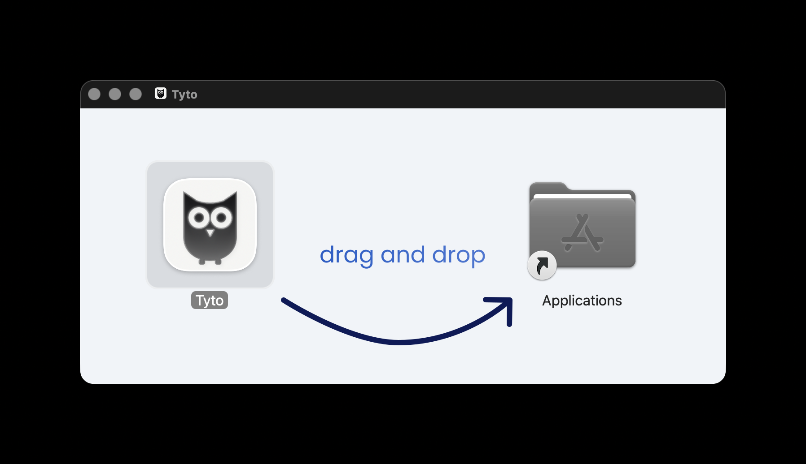
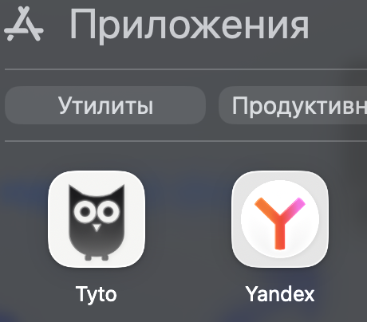
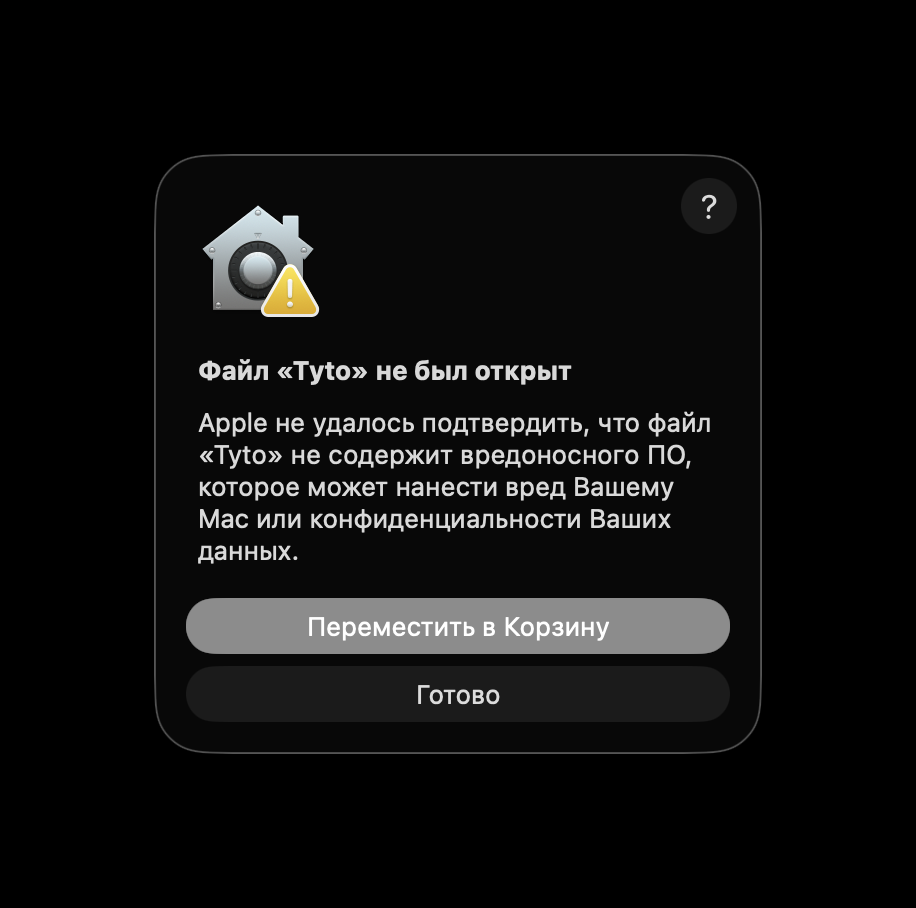
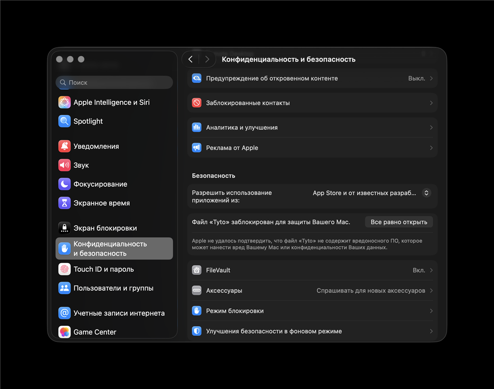
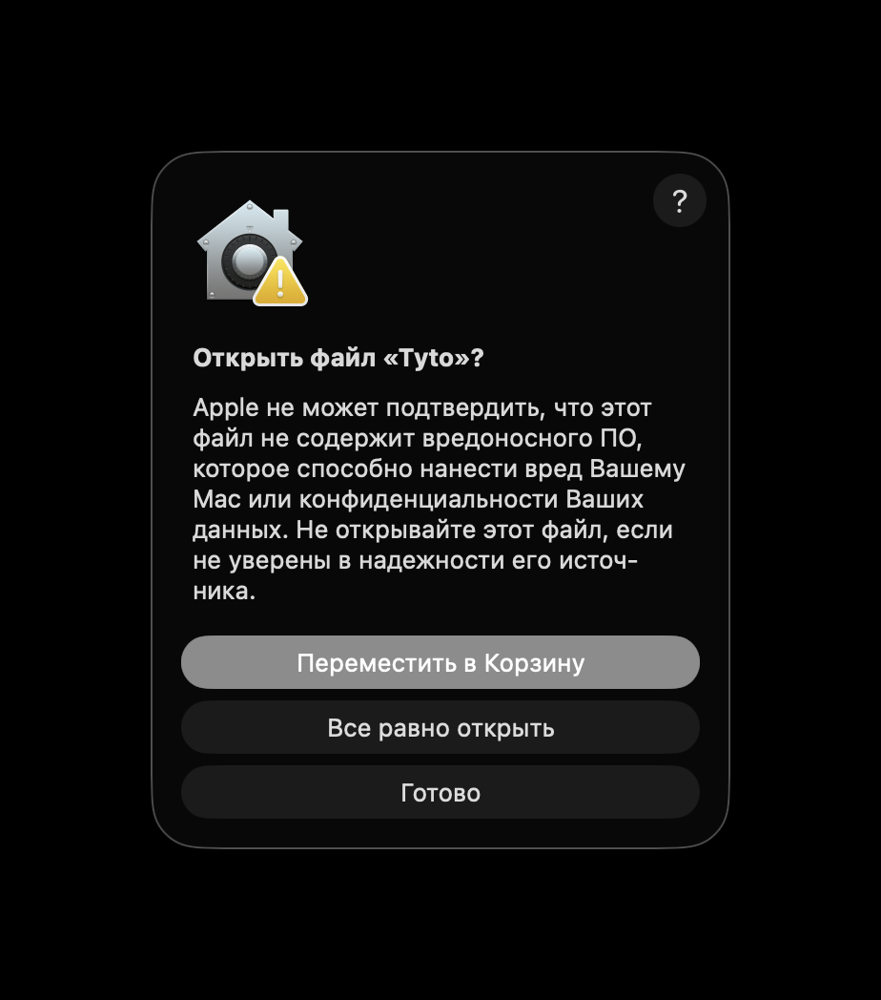

# Установка Tyto

Расшифровка в Tyto идет на вашем компьютере, звук и видео остаются у вас. Если вы включите ИИ-сводку, текст расшифровки уйдет в выбранный вами ИИ-сервис. Скачайте программу по ссылке: https://github.com/des-e/tyto/releases/latest

Предупреждение появляется при первом запуске установщика, и только один раз. Дальше Tyto открывается как обычная программа.

## Windows

1. Скачайте файл `Tyto_x.y.z_x64-setup.exe` (вместо x.y.z будет номер версии) со страницы https://github.com/des-e/tyto/releases/latest и запустите его.
2. Windows покажет синее окно «Windows защитила ваш компьютер». Это нормально: программа пока без платной подписи. Нажмите «Подробнее», затем «Выполнить в любом случае».

   <!-- скриншот: docs/install/win-smartscreen-1.png: окно «Windows защитила ваш компьютер» -->
   <!-- скриншот: docs/install/win-smartscreen-2.png: кнопка «Выполнить в любом случае» после «Подробнее» -->

3. Если установщик пишет «Tyto is running! Click OK to kill it», значит Tyto уже открыта. Нажмите OK, установка продолжится.

   <!-- скриншот: docs/install/win-running.png: окно «Tyto is running! Click OK to kill it» -->

4. После установки откройте Tyto. При первом запуске она скачает модель распознавания речи и модель, которая определяет, кто говорит. Нужен интернет, это займет несколько минут.

   <!-- скриншот: docs/install/win-first-launch.png: первый запуск, загрузка моделей -->

## Mac

Проверено на macOS 26.

1. Скачайте файл `.dmg` со страницы https://github.com/des-e/tyto/releases/latest. Он один для всех маков: и с чипом Apple Silicon, и с Intel. Откройте его и перетащите значок Tyto в папку «Программы» (Applications).

   

   

2. Откройте Tyto. Mac покажет предупреждение «Файл "Tyto" не был открыт». Нажмите «Готово». Кнопку «Переместить в Корзину» нажимать не нужно.

   

3. Откройте «Системные настройки», затем «Конфиденциальность и безопасность». Прокрутите страницу до раздела «Безопасность», там будет строка «Файл "Tyto" заблокирован для защиты Вашего Mac». Нажмите «Все равно открыть». Кнопка остается на странице около часа, потом ее придется вызвать заново, снова открыв Tyto.

   

4. Откройте Tyto еще раз. Mac спросит «Открыть файл "Tyto"?». Нажмите «Все равно открыть» и введите пароль от мака или приложите палец к Touch ID.

   

5. При первом запуске Tyto скачает модель распознавания речи и модель, которая определяет, кто говорит. Нужен интернет, это займет несколько минут.

## Обновления

Когда выходит новая версия, внизу окна рядом с номером версии появляется маленький значок обновления. Нажмите на него, и Tyto обновится сама.

<!-- скриншот: docs/install/update-icon.png: значок обновления рядом с номером версии -->
